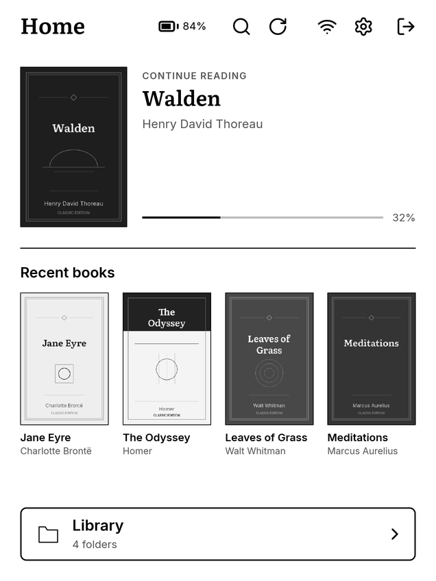
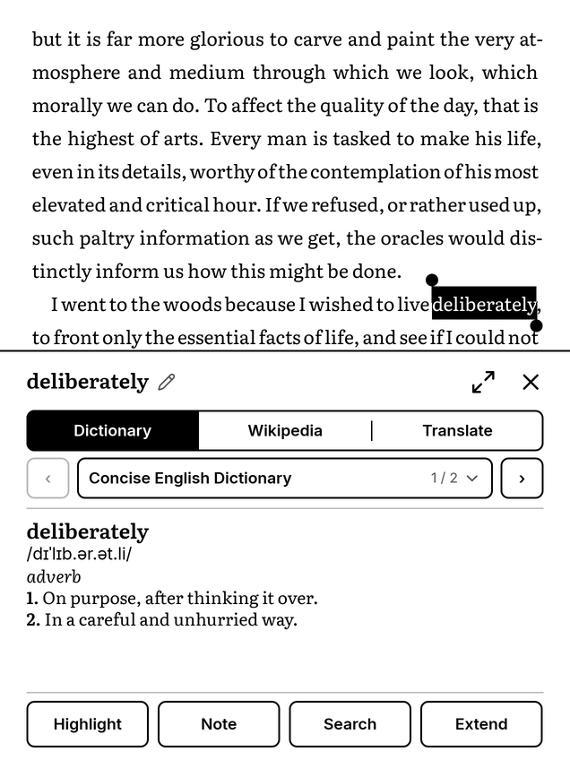

# Verso

A calm, lightweight EPUB reader for jailbroken Kindles, written in Rust.

Verso is an alternative to [KOReader](https://koreader.rocks/) for people who
want good typography, fast page turns and simple controls instead of endless
settings. It runs alongside Amazon's Kindle software (started from KUAL),
pausing the Kindle UI while you read and restoring it cleanly on exit or crash.

<table>
  <tr>
    <td></td>
    <td></td>
    <td></td>
  </tr>
  <tr>
    <td align="center">Home &amp; continue reading</td>
    <td align="center">EPUB typography &amp; footer</td>
    <td align="center">Offline StarDict lookup</td>
  </tr>
</table>

## What Verso is — and isn't

**Verso focuses on reading EPUBs well:**

- **Fast, clean reading:** crengine EPUB layout with bundled Literata, the
  Kindle's built-in fonts and `/mnt/us/fonts`, live typography previews,
  customisable top and bottom bars, footnotes, full-text book search,
  highlights, notes, bookmarks and Markdown export.
- **Calm library:** Home screen with continue reading and recent books, a
  folder browser that uses your existing directory hierarchy, folder cover
  previews, search with an on-screen keyboard, finished-book tracking and
  one-way KOReader progress and highlight import.
- **Offline dictionaries:** StarDict lookup with sets, language routing,
  built-in English and Russian word forms, and optional Hunspell dictionaries
  for other languages. Reuses KOReader's dictionary folder automatically.
- **Built-in Wi-Fi transfer:** a local web app on `http://verso.local` to add
  EPUBs, upload dictionaries, export highlights and manage files from a phone
  or computer, with a 4-digit pairing code and QR code.
- **E-ink native and light:** no animations, targeted dirty-rect refreshes,
  low memory (~25–45 MB resident) and crash-safe launcher recovery.

**What Verso intentionally leaves out:**

- **Not a general system shell.** No plugin ecosystem, terminal, RSS reader or
  cloud sync service. If you want every format and every tweak, KOReader is
  excellent and lives peacefully next to Verso on the same Kindle.

## Supported Kindles

Verso requires a **jailbroken Kindle with KUAL** running **hard-float firmware
(5.16.3 or later)**.

| Status | Models |
| --- | --- |
| **Tested** | Kindle Paperwhite 6 (12th gen, 2024) |
| **Untested (device profiles included)** | Paperwhite 4 (2018), Paperwhite 5 (2021), Basic 3 (2019), Basic 4 (2022), Basic 5 (2024), Oasis 3 (2019), Colorsoft (2024), Scribe (2022–2025) |
| **Not supported** | Older soft-float Kindles (Paperwhite 2/3, Voyage, Oasis 1/2, Basic 1/2) and firmware older than 5.16.3 |

On an untested model, Verso shows a one-time notice at launch. If you try it on
another Kindle, **Settings → Advanced → Create problem report** (or **KUAL →
Verso → Create problem report**) writes a redacted hardware and log report to
`verso/reports/` that helps mark your model tested.

## Install and update

1. Install a Kindle jailbreak and **KUAL** (not covered here).
2. Download `verso-<version>.zip` from [GitHub Releases](https://github.com/ShaderCompilation/Verso/releases).
3. Connect the Kindle by USB and unpack the zip into the root of its USB
   storage so it creates `verso/` and `extensions/verso/` next to `documents/`.
4. Safely eject the Kindle and start Verso from **KUAL → Verso → Start Verso**.

Once installed, Verso checks for signed updates over HTTPS (daily when Wi-Fi is
connected, or manually from **Settings → Device → Check for updates**). Updates
verify minisign signatures and SHA-256 hashes, switch files atomically through
the launcher and roll back automatically if a new version fails to start. You
can also revert manually from **Settings → Device → Go back**.

To uninstall, delete `verso/` and `extensions/verso/` over USB. Verso never
modifies system partitions, `/etc`, `/var/local`, jailbreak files or your books.

## Build from source

Verso includes a desktop simulator (`cargo sim`) so you can run and test most
changes without a Kindle, and cross-compiles for ARM Kindles via Zig:

```sh
git submodule update --init --recursive --depth 1

cargo sim           # build and run the desktop simulator
cargo test          # run the test suite
cargo kindle-build  # release build for hard-float Kindles (needs zig + cargo-zigbuild)
```

See [CONTRIBUTING.md](CONTRIBUTING.md) for the full toolchain setup, simulator
device presets and verification rules.

## Documentation

- [User guide](docs/user-guide.md) — installation, reading, library,
  dictionaries, Wi-Fi transfer, KOReader import, updates and problem reports.
- [Architecture](docs/architecture.md) — crates, layers, threads, rendering,
  file formats and cross-module invariants.
- [Kindle notes](docs/kindle-notes.md) — hardware, FBInk, evdev input,
  launcher coexistence, `powerd`/`lipc`, battery/USB and networking facts.
- [Contributing](CONTRIBUTING.md) — setup, commands, checks and commit style.

## Status

Verso is in early development (`v0.1`). It is used daily on a Kindle Paperwhite
6 (2024), while multi-device support, overnight hibernation checks and final
release polish are still underway. File issues with a redacted problem report
from `verso/reports/` when something misbehaves on your device.

## License

Verso is licensed under the **GNU Affero General Public License v3.0 or later**
(`AGPL-3.0-or-later`). See [LICENSE](LICENSE).

Third-party libraries, fonts, icons and word-form datasets keep their own
licenses; see [NOTICE.md](NOTICE.md).
